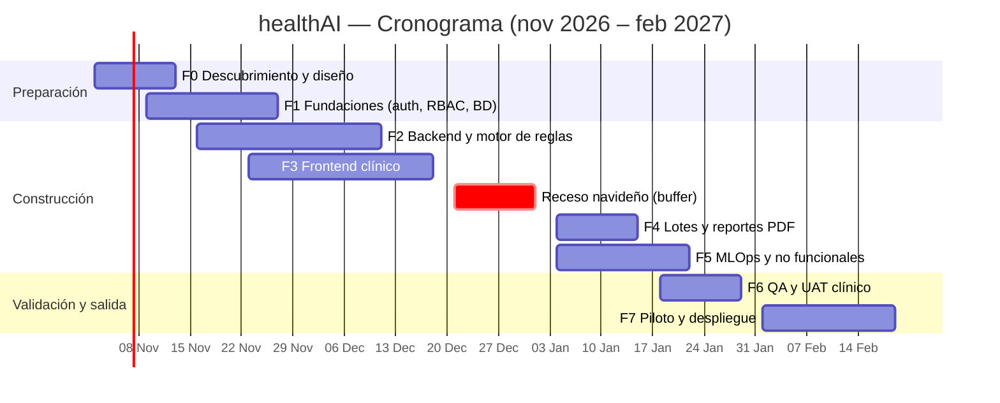

# healthAI — Plataforma Web de Acceso al Modelo de IA

> **Modelo de Predicción basado en IA para la detección temprana de trastornos mentales en Pacientes Diabéticos Tipo II en Riesgo de Amputación**
> Centros de Atención Primaria de Barranquilla, Riohacha y Valledupar
> Convenio 112721-224-2025 (Convocatoria 963 de 2025) · Universidad de la Costa (CUC)

| | |
|---|---|
| **Estado** | Planeación |
| **Inicio propuesto** | Lunes 2 de noviembre de 2026 |
| **Entrega (go-live en las 3 sedes)** | Viernes 19 de febrero de 2027 |
| **Duración** | 16 semanas calendario (≈ 14 efectivas, con receso navideño) |
| **Esfuerzo estimado** | ≈ 153 persona-día |
| **Insumos** | Especificación de requisitos (RF01–RF06, RNF01–RNF04) y prototipo interactivo `interactive_ui_ux_specifications_for_ml_health_platform.html` |

---

## 1. Qué es healthAI

Aplicación web para que el personal de atención primaria registre el tamizaje de un paciente con DM2 (datos clínicos, WHO-5 y DASS-21), lo envíe al modelo de IA (Regresión Logística L2, subconjunto S2, servido por FastAPI) y reciba:

1. Probabilidad de requerir **Ruta A** (P(RA)) y ruta base (A o B).
2. Nivel de confianza por concordancia con modelos retadores (KNN, MLP, consenso).
3. Explicabilidad individual (Top 3 SHAP).
4. Escalamiento determinístico por las **reglas clínicas R1–R5** y la regla de seguridad.
5. Acciones diferenciadas por ruta, **decisión final del profesional** (human-in-the-loop) y reporte PDF.

El prototipo HTML es la referencia visual (modo Mockup y Wireframe, paleta CUC, simulación de los 6 módulos). **No tiene backend real**: toda la lógica es simulada en el navegador, por lo que el trabajo consiste en construir el producto real siguiendo ese diseño.

## 2. Arquitectura propuesta (RNF04.3 — desacople estricto)

```
┌────────────┐  HTTPS/JWT  ┌──────────────────┐  JSON   ┌────────────────────┐
│  Frontend  │────────────▶│  Backend (BFF)   │────────▶│ API del modelo     │
│  React SPA │             │  FastAPI         │ /predecir│ FastAPI (existente)│
└────────────┘             │  auth · RBAC     │ /salud  └────────────────────┘
                           │  validación 422  │
                           │  auditoría       │  import  ┌────────────────────┐
                           │  seudonimización │─────────▶│ motor_reglas.py    │
                           │  PDF · batch     │  (paquete │ umbrales en config │
                           └────────┬─────────┘  versionado)└──────────────────┘
                                    │
                           ┌────────▼─────────┐
                           │ PostgreSQL       │  evaluaciones, bitácora
                           │ (append-only log)│  inmutable, decisiones, telemetría
                           └──────────────────┘
```

**Stack sugerido** (a confirmar en F0): React + TypeScript + Vite + Tailwind + Chart.js (coherente con el prototipo) · FastAPI + Pydantic · PostgreSQL · Docker Compose · Nginx con TLS · GitHub Actions · pytest, Vitest y Playwright.

**Estructura de repositorio sugerida**

```
healthAI/
├── frontend/        # SPA (stepper, resultados, XAI, PDF)
├── backend/         # BFF: auth, contrato de datos, auditoría, batch, telemetría
├── rules-engine/    # motor_reglas.py + config de umbrales (YAML/JSON) + tests
├── infra/           # docker-compose, nginx, CI/CD, scripts de despliegue
├── docs/            # diccionario de datos v2.1, ADRs, manual de usuario
└── README.md
```

## 3. Supuestos del plan

- Equipo de **3 personas**: (A) full-stack/frontend, (B) backend + MLOps, (C) QA / analista clínico a ~60 %. Un referente clínico de la CUC disponible para validar reglas y UAT.
- La API del modelo (`POST /predecir`, `GET /salud`, artefacto `modelo_rutal_reglog_s2.joblib` v1.0.0) **ya existe** y está documentada. Si no, el plan crece ~3–4 semanas.
- Infraestructura de despliegue (servidor/nube de la CUC) y dominio con TLS disponibles desde la semana 3.
- Aprobaciones éticas y de tratamiento de datos (Ley 1581/2012, Res. 8430/1993) gestionadas en paralelo por el equipo investigador; **son prerrequisito del piloto** (F7).
- Festivos colombianos considerados: 8 dic, 25 dic, 1 ene, 11 ene. Semanas 8–9 (21 dic – 1 ene) con capacidad mínima.

## 4. Cronograma

| Fase | Contenido | Semanas | Fechas | Persona-día |
|---|---|---|---|---|
| **F0** Descubrimiento y diseño | Cierre de decisiones abiertas (§7), diccionario de datos, diseño UI final, backlog | S1–S2 | 2 nov – 13 nov | 10 |
| **F1** Fundaciones | Repos, CI/CD, entornos, BD, autenticación JWT y RBAC, selección de sede | S2–S4 | 9 nov – 27 nov | 15 |
| **F2** Backend y motor de reglas | Contrato de datos + 422, proxy a `/predecir` y `/salud`, `motor_reglas.py` R1–R5 + regla de seguridad, seudonimización, bitácora inmutable, endpoint de decisión humana | S3–S6 | 16 nov – 11 dic | 30 |
| **F3** Frontend clínico | Login/sedes, stepper (Clínicos → Hábitos → WHO-5 → DASS-21), validación en tiempo real, resultados P(RA), confianza, SHAP, panel de reglas, decisión del profesional, disclaimer | S4–S7 | 23 nov – 18 dic | 30 |
| *Receso* | Capacidad mínima / buffer | S8–S9 | 21 dic – 1 ene | — |
| **F4** Lotes y reportes | Carga CSV/XLSX, validación por fila, descarga unificada, verificación SHA-256, exportación PDF para HCE | S10–S11 | 4 ene – 15 ene | 15 |
| **F5** MLOps y no funcionales | Telemetría PSI/KS y concordancia (concept drift), pruebas de carga (≤ 2 s, 3 sedes), seguridad, accesibilidad, versionado visible | S10–S12 | 4 ene – 22 ene | 20 |
| **F6** QA y UAT clínico | Pruebas E2E, casos clínicos de borde, UAT con profesionales, corrección de defectos | S12–S13 | 18 ene – 29 ene | 15 |
| **F7** Piloto y despliegue | Despliegue productivo, capacitación, piloto en BAQ/RHA/VUP, monitoreo, entrega documental | S14–S16 | 1 feb – 19 feb | 18 |
| | | **Total** | | **≈ 153** |



### Hitos

| Hito | Fecha | Criterio de salida |
|---|---|---|
| **M1** Diseño aprobado | 13 nov 2026 | Decisiones de §7 cerradas; diccionario v2.1 congelado |
| **M2** Flujo individual end-to-end | 18 dic 2026 | Login → formulario → predicción → reglas → decisión humana funcionando en staging |
| **M3** Funcionalidad completa | 22 ene 2027 | Todos los RF implementados; telemetría y PDF activos |
| **M4** UAT firmado | 29 ene 2027 | Sin defectos críticos/altos abiertos; validación clínica de reglas |
| **M5** Go-live 3 sedes | 19 feb 2027 | Producción estable, capacitación hecha, manual entregado |

## 5. Plan por fase (entregables y criterios de aceptación)

### F0 — Descubrimiento y diseño (10 pd)
- Resolver las inconsistencias detectadas entre especificación y prototipo (§7).
- Entregables: ADRs de stack, diccionario de datos v2.1 en `docs/`, diseño UI final, backlog priorizado por RF.
- Aceptación: aprobación del investigador principal y del referente clínico.

### F1 — Fundaciones (15 pd)
- Monorepo, linters, CI (lint + test + build), entornos dev/staging, Docker Compose, TLS.
- Autenticación JWT (expiración 8 h), **RBAC asignado en servidor** (Evaluador / Investigador-Admin), sede obligatoria (`BAQ`, `RHA`, `VUP`) → RF01.1, RF01.2.
- Aceptación: un Evaluador no accede a rutas de Investigador; cada sesión queda ligada a profesional + sede + marca de tiempo.

### F2 — Backend y motor de reglas (30 pd)
- Esquemas Pydantic que replican el contrato: V8 (0–80), V9 y V11 binarios independientes, V12/V13/V15 (1–5), V14 (0–3), WHO-5 (0–25), DASS-21 (21 ítems 0–3, subescalas 0–21), ítem 21 con validación crítica → RF02.
- **Excluir `Nivel_de_Riesgo` (ADA/IWGDF) del payload al modelo**; solo alimenta el motor de reglas → RF02.4.
- Proxy a `POST /predecir` y `GET /salud` (timeouts, reintentos, estado del servicio) → RF03.1, RF03.3.
- `motor_reglas.py` desacoplado, con umbrales en configuración → RF05.1, RNF04.3:
  - R1 ítem 21 ≥ 2 o no evaluable · R2 subescala severa/extrema · R3 WHO-5 ≤ 28 % · R4 ≥ 2 subescalas ≥ moderado · R5 ≥ 3 de 4 marcadores · regla de seguridad (no anulable por software).
- Seudonimización (nunca cédula/nombre en claro), bitácora append-only con ID de transacción, profesional, variables, versión del modelo, ruta y decisión → RNF01.2, RNF01.3.
- Endpoint de decisión humana (confirmar / rechazar / ajustar) → RF06.
- Aceptación: suite de pruebas con tabla de verdad de R1–R5 y casos de borde (p. ej. ítem 21 ausente); rechazo 422 ante cualquier valor fuera de rango.

### F3 — Frontend clínico (30 pd)
- Stepper con indicador de completitud y bloqueo de envío incompleto → RNF03.2.
- Validación en tiempo real con alertas visuales → RF02.3; cálculo automático WHO-5 (bruto y %) y totales DASS-21.
- Pantalla de resultados: P(RA), ruta, confianza (Alta/Media/Baja), Top 3 SHAP con dirección, reglas disparadas, acciones por ruta → RF04, RF05.2.
- **Disclaimer permanente** en toda pantalla de reporte → RF05.3. Versiones visibles (sistema, modelo v1.0.0, diccionario v2.1) en cabecera y pie → RNF04.1.
- Diseño responsivo (escritorio y tableta) con identidad CUC → RNF03.1.
- Aceptación: flujo completo con el caso Anexo E del prototipo reproduce los mismos resultados esperados.

### F4 — Lotes y reportes (15 pd)
- Carga `.csv`/`.xlsx` con plantilla oficial, validación por fila con reporte de errores, procesamiento asíncrono, descarga de base unificada y verificación SHA-256 → RF03.2.
- Exportación/impresión PDF del tamizaje y enrutamiento para la HCE → RNF03.3.

### F5 — MLOps y no funcionales (20 pd)
- Telemetría hacia backend para PSI y Kolmogorov-Smirnov por variable (data drift) y registro de concordancia modelo vs. profesional (concept drift); disparador de revisión al acumular ≥ 30 decisiones → RNF04.2, RF06.2.
- Panel de Investigador: métricas globales y descarga de auditoría → RF01.1.
- Pruebas de carga (k6/Locust): ≤ 2 s extremo a extremo, concurrencia de 3 sedes → RNF02.1, RNF02.3. Monitoreo y alertas para disponibilidad ≥ 99,5 % → RNF02.2.
- Revisión de seguridad (OWASP, TLS, cabeceras, gestión de secretos) y accesibilidad (WCAG AA).

### F6 — QA y UAT clínico (15 pd)
- E2E con Playwright, regresión de reglas, pruebas de datos anómalos y de caída del servicio de modelo (degradación controlada).
- UAT con al menos un profesional por sede; acta de aceptación.

### F7 — Piloto y despliegue (18 pd)
- Despliegue productivo con respaldo y plan de rollback; capacitación por sede; piloto supervisado de 2 semanas; hipercuidado post-lanzamiento.
- Entregables: manual de usuario, manual técnico/operativo, runbook de incidentes, informe de piloto.

## 6. Trazabilidad requisitos → fases

| Requisito | Fase(s) |
|---|---|
| RF01 Autenticación, roles, trazabilidad | F1, F5 (panel investigador) |
| RF02 Captura y validación | F2, F3 |
| RF03 Inferencia, lotes, estado | F2, F4 |
| RF04 Resultados y XAI | F3 |
| RF05 Reglas y recomendaciones | F2, F3 |
| RF06 Human-in-the-loop | F2, F3, F5 |
| RNF01 Seguridad y privacidad | F1, F2, F5, F7 |
| RNF02 Rendimiento y disponibilidad | F5, F6, F7 |
| RNF03 Usabilidad y PDF | F3, F4 |
| RNF04 MLOps y modularidad | F2, F3, F5 |

## 7. Decisiones abiertas e inconsistencias a resolver en F0

Detectadas al comparar la especificación con el prototipo:

1. **Rol elegido por el usuario**: el prototipo permite escoger rol en un `select` al ingresar. El rol debe asignarlo el servidor (RBAC); además la especificación define 2 perfiles y el prototipo muestra 4 (Médico, Psicólogo, Enfermería, Investigador). Definir si son 4 roles o 2 perfiles con cargo informativo.
2. **Rango de V8**: especificación 0–80 años; el prototipo usa un slider 0–60. Se seguirá la especificación.
3. **V9 y V11**: la especificación pide casillas binarias independientes (incluye *Ninguna/Ninguno* y *Otra*); el prototipo usa un selector único para V9 y no incluye *Ninguna* ni *Otra* en V11. Definir reglas de exclusión (p. ej. "Ninguna" excluye el resto).
4. **WHO-5 y DASS-21**: el prototipo captura totales con sliders; la especificación exige los 5 y 21 ítems individuales (o cálculo automático). Se implementarán ítems individuales con totales calculados.
5. **Ítem 21 "no evaluable"**: definir cómo se captura (opción explícita "no evaluable") ya que activa R1.
6. **Consenso de modelos**: el prototipo habla de "6 modelos"; la especificación nombra KNN, MLP y consenso. Confirmar qué devuelve exactamente la API.
7. **Formato de la bitácora "inmutable"**: tabla append-only con hash encadenado vs. almacenamiento WORM externo.
8. **Hosting y PDF**: infraestructura de despliegue y si el PDF se genera en servidor (reproducible, auditable) o con impresión del navegador.

## 8. Riesgos

| Riesgo | Prob. | Impacto | Mitigación |
|---|---|---|---|
| API del modelo no estable o sin contrato formal | Media | Alto | Contrato OpenAPI congelado en F0; mock del modelo para desarrollo en paralelo |
| Aprobación ética / datos tarda más que F7 | Media | Alto | Gestionar desde la semana 1; piloto con datos sintéticos como plan B |
| Cambio de umbrales clínicos tardío | Media | Medio | Umbrales en configuración versionada, no en código (RNF04.3) |
| Receso de diciembre y festivos reducen capacidad | Alta | Medio | Buffer S8–S9 ya incluido; F3 cierra antes del receso |
| Latencia > 2 s por cold start del modelo | Baja | Medio | Warm-up, caché de artefacto, pruebas de carga en F5 |
| Baja adopción por conectividad en sedes (Riohacha) | Media | Medio | Pruebas de red lenta, mensajes de reintento, capacitación en sitio |

## 9. Definición de terminado (DoD)

- Código revisado por pares, con pruebas unitarias y de integración en verde en CI.
- Ninguna variable fuera de rango llega al modelo (422 cubierto por pruebas).
- `Nivel_de_Riesgo` verificado como ausente del payload predictor.
- Disclaimer visible en todas las pantallas de reporte y en el PDF.
- Cada inferencia genera entrada en la bitácora con modelo v1.0.0 y diccionario v2.1.
- Documentación actualizada.

## 10. Disclaimer clínico

> Herramienta de apoyo a la toma de decisiones clínicas. Las recomendaciones automatizadas no reemplazan el juicio profesional ni constituyen diagnóstico clínico.

---
*Universidad de la Costa — CUC · Barranquilla, Colombia · Documento de planeación generado el 27 de octubre de 2026. Las fechas y esfuerzos son estimaciones sujetas a los supuestos de la §3.*
